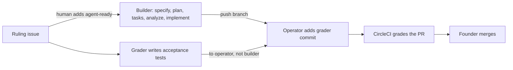

# Spec-driven development in Presenter (multi-agent)

Presenter is built by several agents — **Claude Code**, **OpenCode**, and **Grok Bot** (via the
Decision Crafters Agent Relay) — plus one human who decides and merges. This page adapts the
[Invoice Exception Desk playbook](https://raw.githubusercontent.com/tosin2013/invoice-exception-desk/refs/heads/main/PLAYBOOK.md)
to that setup. The rules themselves are in [`.specify/memory/constitution.md`](../.specify/memory/constitution.md).

> Unattended doesn't mean unreviewed: decide everything before the run, check everything after it.

## When to use it

Use a **ruling issue** when a change has a checkable "done", is bigger than one sitting, could be
quietly wrong (rendering, narration, metadata), or will be built by an agent while someone else
checks it. Use a **normal PR** for typos, small fixes, config changes, dependency bumps, and
prototypes. Both are CI-graded and human-merged.

## Roles

| Role | Who | Does | Never does |
|---|---|---|---|
| Founder | human | rules on the change, adds `agent-ready`, merges every PR | merges without looking at CI |
| Builder | Claude Code, OpenCode, or Grok Bot (named in the issue) | writes the spec trail and the code from the ruling | sees or edits the grader's tests; touches forbidden files |
| Grader | a different agent, or the Founder | writes `acceptance/issue-<N>/` from the issue's exact inputs | grades its own work |
| Operator | whoever the issue names (often Claude Code when it isn't building) | verifies the builder's push, adds the grader commit, opens the PR | edits the builder's commits |
| CI | CircleCI `build-and-test` (required on `master`) | ruff, mypy, pytest, acceptance, base test IDs, diff summary | uses secrets or deploys |
| Dependabot | bot | opens grouped weekly pip PRs | merges anything |

## The loop

1. **Ruling.** Open an issue from the `Ruling` template. Name the builder, the grader (different), and
   the operator. Give given/when/then checks with exact inputs, forbidden files, allowed test
   edits, limits, and "stop and ask". The Founder adds `agent-ready` only when it's final.
2. **Grader.** Writes `acceptance/issue-<N>/test_*.py` from the issue alone and hands it to the
   operator. If the ruling allows removing a test, the grader lists its exact ID in
   `acceptance/issue-<N>/allowed-missing.txt`. For Grok Bot, the handoff is a relay message
   addressed to the operator/Founder.
3. **Builder.** On branch `pilot/issue-<N>` (or `feat/…`): `/speckit.specify`, `/speckit.clarify`,
   `/speckit.plan`, `/speckit.tasks`, `/speckit.analyze` (fix HIGH findings), `/speckit.implement`.
   Commit the trail under `specs/<NNN>-<name>/` with the code, then push. The builder must not read
   the grader's tests or relay reply first.
4. **Grader commit.** The operator adds the acceptance tests as **one separate commit** on top of the
   builder's unchanged commits, then opens the PR. The PR history shows who wrote what.
5. **CI grades.** `scripts/ci_grade.py` runs the acceptance tests, checks every test ID from the
   merge-base still exists, and prints the diff size.
6. **Founder merges** on green and closes the issue.

## Agents and integrations

- **Claude Code** — Spec Kit `claude` integration (default; skills in `.claude/skills/speckit-*`).
- **OpenCode** — Spec Kit `opencode` integration (`.opencode/commands/`). OpenCode 2.x may not
  support scripted `opencode run --command` (spec-kit #4639); run it interactively, or let Claude
  build. When scripting, add `< /dev/null` so it can't hang on input.
- **Grok Bot** — no Spec Kit integration; follows `AGENTS.md` and the templates in
  `.specify/templates/` directly, and talks through the Agent Relay.

Spec Kit is pinned at `specify` 1.2.0. Upgrade it as its own PR after a dry run in a throwaway
clone (playbook L4.5).

## Gap audit at adoption (2026-10-28, `master` @ 877af41)

| Practice | Before | After this setup |
|---|---|---|
| Human merges every PR, no auto-merge | ✅ | ✅ |
| CI grades every PR | ⚠️ ruff, mypy, pytest only | ✅ plus acceptance, base test IDs, diff summary |
| Required check on `master` | ❌ | ✅ `ci/circleci: build-and-test` required |
| Constitution, rulings, spec trail | ❌ | ✅ constitution v1.0.0, ruling template, Spec Kit |
| Grader the builder never sees | ❌ | ✅ by process (separate grader + grader commit) |
| Test baseline | ❌ | ✅ `.specify/memory/test-baseline.txt` |
| Dependabot | ❌ | ✅ weekly grouped pip |

## Known gaps

- **Agents push with the Founder's credentials.** There is no keyless build box yet, so "the
  builder can't push" and "the builder can't read the grader" are enforced by process, not by
  permissions.
- **CI checks that base test IDs exist, not what they contain.** A weakened test that keeps its name
  passes. Review any PR that edits existing tests.
- **Dependabot can't update `.circleci/config.yml`**; bump the CI image by hand.
- **No automatic pickup of `agent-ready` issues** and no `needs-human` automation. A human starts each run.
- **Required reviews are off** (solo maintainer); the required check is CI only.
